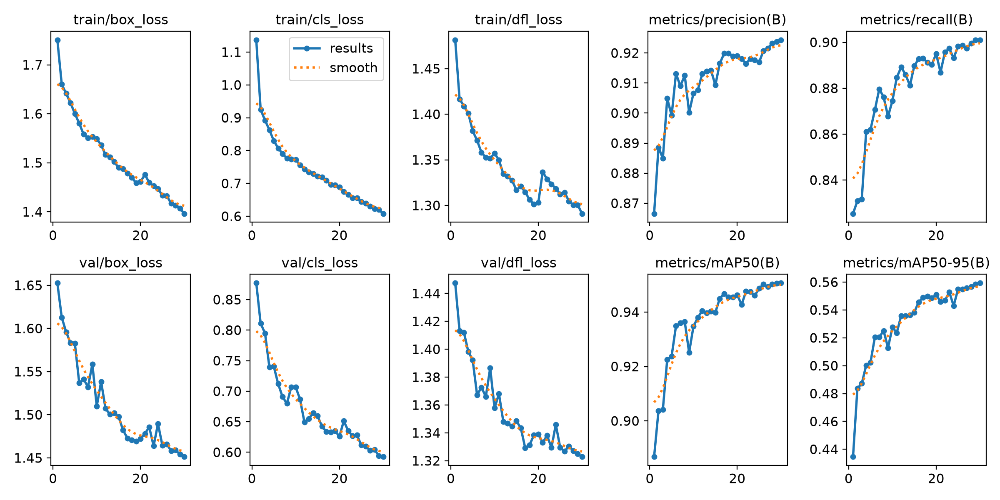
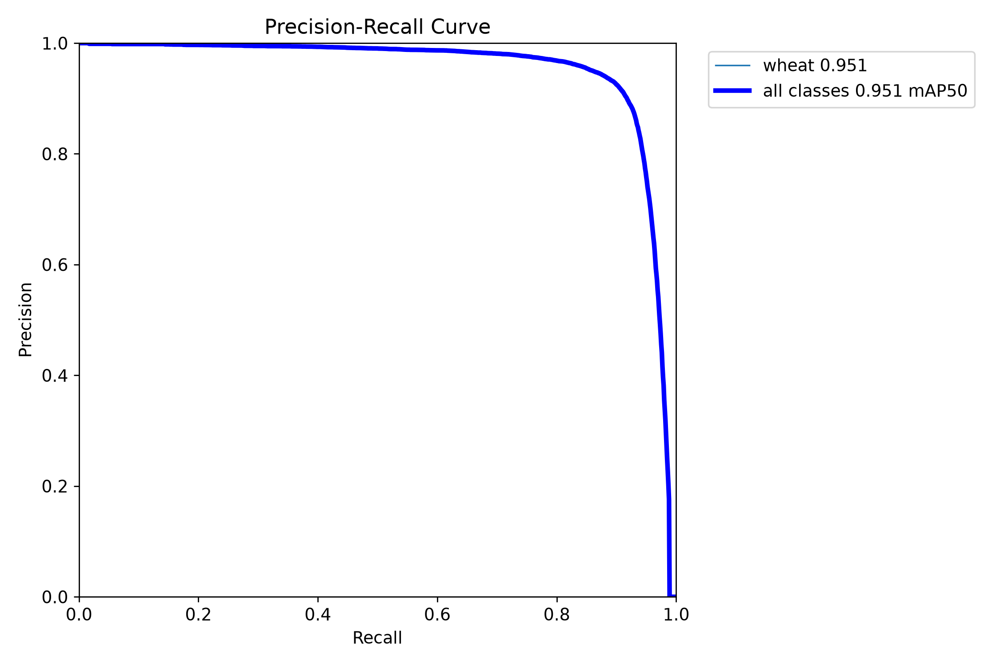
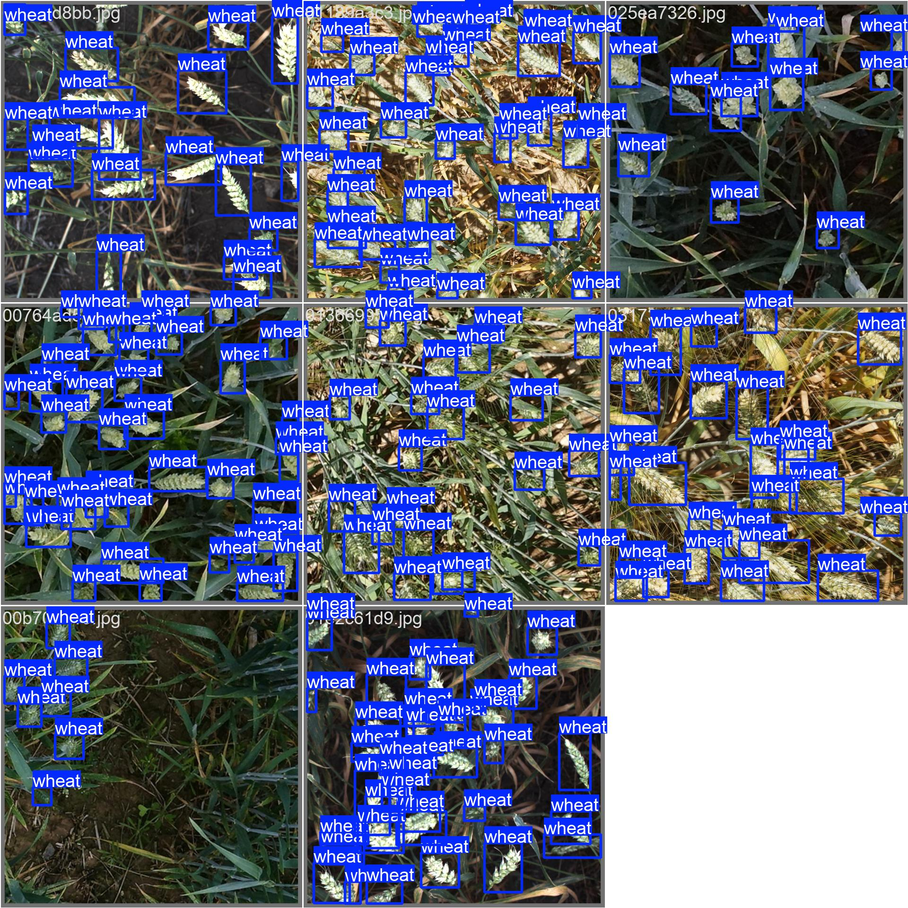
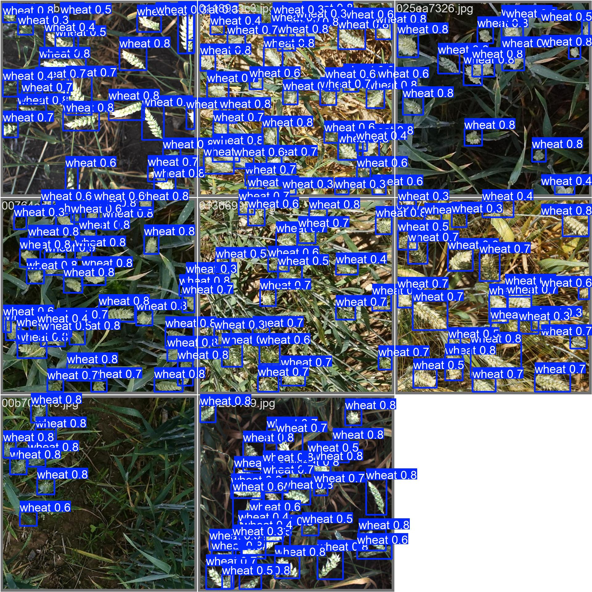
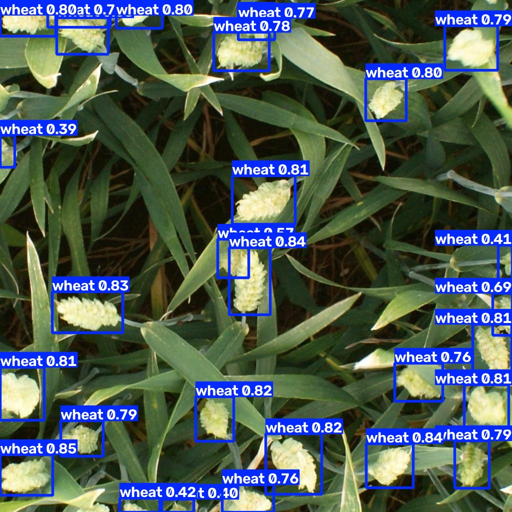
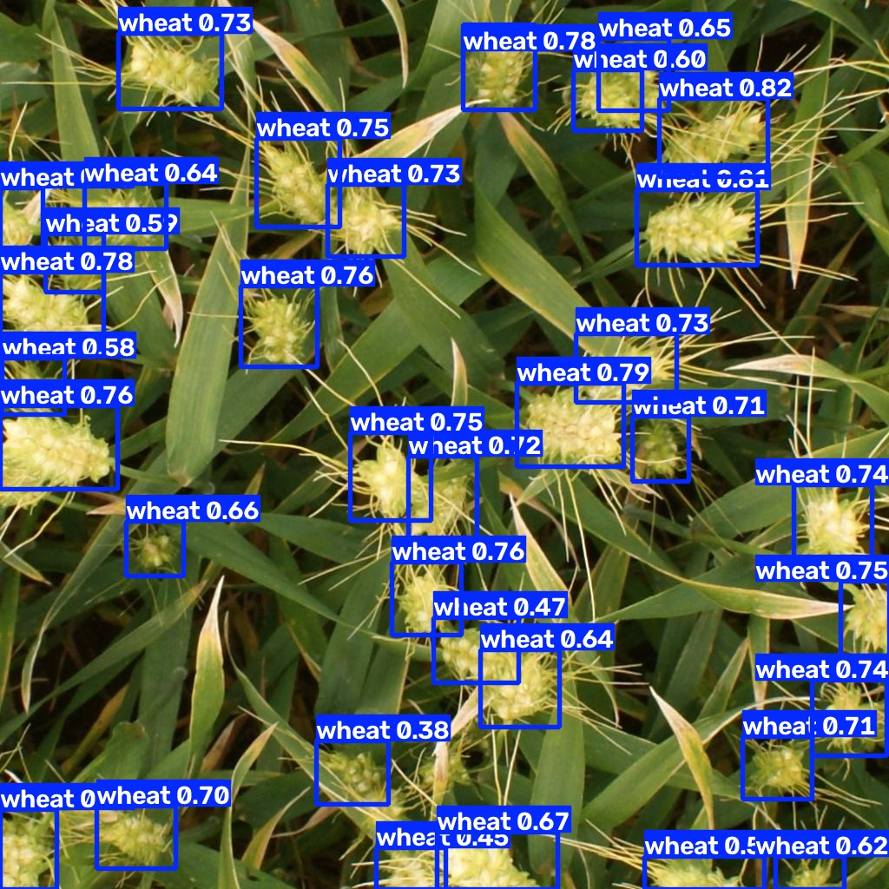

# 🌾 Global Wheat Detection - YOLOv8 物件偵測復刻專案

本專案復刻自 Kaggle 經典電腦視覺競賽 **[Global Wheat Detection](https://www.kaggle.com/competitions/global-wheat-detection/overview)**。透過 Ultralytics YOLOv8 框架，完成從原始競賽資料清洗、標註格式轉換、遷移學習模型訓練，到測試集推論與視覺化的完整物件偵測工作流（Pipeline）。

---

## 📁 專案目錄結構

```text
global-wheat-yolo/
├── assets/                         # README 說明文件展示圖表與預測範例
├── data/
│   ├── raw/                        # Kaggle 原始資料集 (train/, test/, train.csv)
│   └── yolo_dataset/               # 轉換後的 YOLO 標準格式資料集
│       ├── images/ (train, val)    # 80% 訓練集 / 20% 驗證集影像
│       └── labels/ (train, val)    # 歸一化後的 .txt 標註檔 (一圖一檔)
├── runs/
│   └── wheat/
│       ├── yolov8s_run1/           # 模型訓練產出 (權重 best.pt、Loss 曲線、PR 曲線等)
│       └── test_predictions/       # 測試集推論之視覺化結果圖片 (*_pred.jpg)
├── prepare_data.py                 # 資料前處理與格式轉換腳本
├── wheat.yaml                      # YOLO 資料集路徑與類別設定檔
├── train.py                        # 模型訓練腳本
├── inference.py                    # 測試集推論、繪製預測框與生成 submission.csv 腳本
├── submission.csv                  # 符合 Kaggle 競賽規格之最終預測輸出檔
└── README.md                       # 專案說明文件
```

---

## ⚙️ 硬體與環境配置

* **作業系統**: Windows 11
* **GPU**: NVIDIA GeForce RTX 4060 Laptop GPU (CUDA 12.1)
* **Python 版本**: Python 3.9+

### 環境安裝步驟

```powershell
# 1. 建立並啟動虛擬環境
python -m venv .venv
.\.venv\Scripts\activate

# 2. 安裝支援 CUDA 12.1 之 PyTorch GPU 版本
pip install torch torchvision torchaudio --index-url https://download.pytorch.org/whl/cu121

# 3. 安裝專案所需套件
pip install ultralytics pandas scikit-learn tqdm opencv-python kaggle
```

---

## 🚀 執行流程 (Workflow Pipeline)

### Step 1. 資料前處理與標註格式轉換 (`prepare_data.py`)

Kaggle 原始 `train.csv` 提供的標註格式為左上角像素絕對座標 `[xmin, ymin, width, height]`，而 YOLO 訓練要求每張圖片對應一個 `.txt` 標註檔，且數值必須為歸一化（0 ~ 1 之間）的中心點座標與寬高比例。

轉換公式如下：

```math
\begin{aligned}
x_{\text{center}} &= \frac{x_{\min} + \text{width} / 2}{\text{image\_width}} \\
y_{\text{center}} &= \frac{y_{\min} + \text{height} / 2}{\text{image\_height}} \\
w_{\text{norm}} &= \frac{\text{width}}{\text{image\_width}} \\
h_{\text{norm}} &= \frac{\text{height}}{\text{image\_height}}
\end{aligned}
```

執行轉換腳本（自動完成格式轉換與 80% 訓練集 / 20% 驗證集切分）：

```powershell
python prepare_data.py
```

### Step 2. 模型訓練 (`train.py`)

透過 `wheat.yaml` 指定資料集路徑與類別（`0: wheat`），並載入 YOLOv8 預訓練權重進行遷移學習（Transfer Learning）：

```powershell
python train.py
```
* 訓練完成後，驗證集表現最佳之權重會自動儲存於：`runs/wheat/yolov8s_run1/weights/best.pt`。

### Step 3. 測試集推論與視覺化輸出 (`inference.py`)

載入最佳權重 `best.pt`，對 `data/raw/test/` 中的測試影像進行推論：
1. 將預測邊界框（Bounding Boxes）與信心度繪製於測試影像上，儲存至 `runs/wheat/test_predictions/`。
2. 將預測框座標還原為競賽要求的 `PredictionString` 格式（`confidence xmin ymin width height`），輸出至 `submission.csv`。

```powershell
python inference.py
```

---

## 📊 訓練成果與視覺化評估

### 1. 訓練收斂曲線 (`results.png`)
包含訓練集與驗證集之 `box_loss`、`cls_loss`、`dfl_loss` 下降趨勢，以及 `Precision`、`Recall`、`mAP@50`、`mAP@50-95` 隨 Epoch 提升之收斂情形：

<p align="center">
  
</p>

### 2. Precision-Recall 曲線 (`BoxPR_curve.png`)
模型於驗證集上之整體準確率與召回率表現：

<p align="center">
  
</p>

### 3. 驗證集真實標註 vs 模型預測對比
左側為人工真實標註（Ground Truth），右側為模型預測結果（Predictions）：

| 真實標註 (Ground Truth) | 模型預測 (Predictions) |
| :---: | :---: |
|  |  |

### 4. 測試集推論成果範例 (Test Predictions)
模型對 Kaggle 未標記測試集影像的推論與麥穗偵測成果（信心度閾值 `conf = 0.4`）：

| 測試集推論範例 1 (`2fd875eaa`) | 測試集推論範例 2 (`348a992bb`) |
| :---: | :---: |
|  |  |

---

## 📝 上台演示快速指令 (Live Demo)

```powershell
# 1. 檢查 GPU 環境
python -c "import torch; print('GPU:', torch.cuda.get_device_name(0))"

# 2. 現場執行測試集推論與視覺化輸出 (約 3~5 秒)
python inference.py
```
